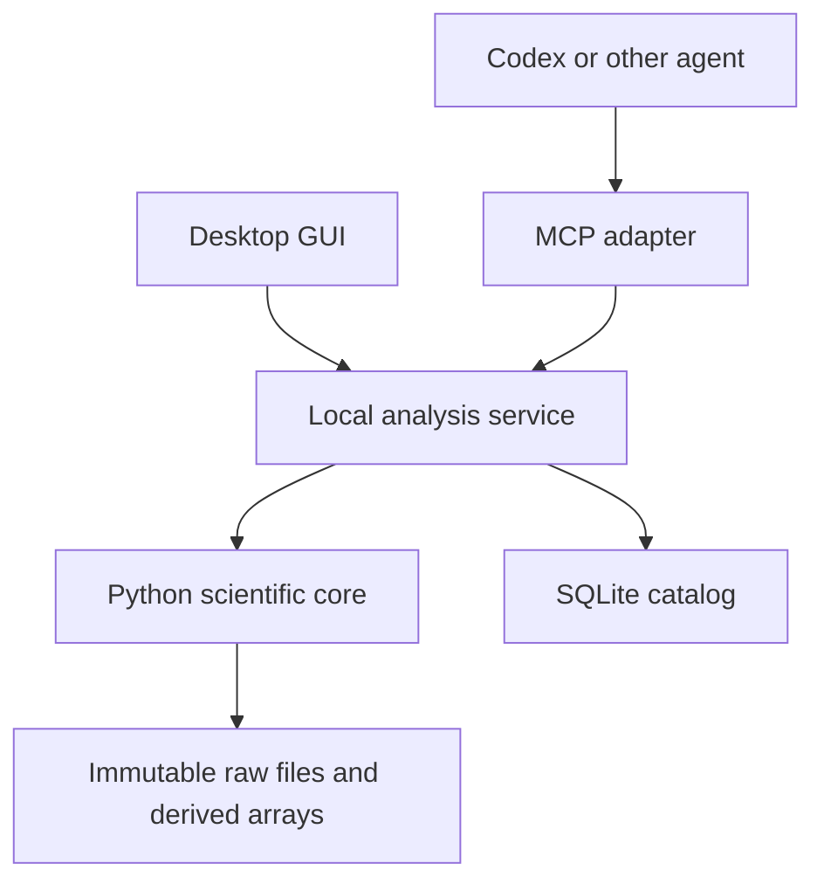

# AFM Workbench Design Proposal

> Implementation update, 2026-11-09: the user authorized building the product with independent decisions, asked for each folder to remain one session, and requested a sample map using TIFF positions. The current implementation uses Python/pywebview with local HTML/CSS/JavaScript and the same scientific service for GUI and MCP. See [README](README.md), [architecture](docs/architecture.md) and [validation](docs/validation.md). The proposal below is retained as design context; it is not a claim that every proposed feature has shipped.

Build a standalone AFM analysis application for public distribution through GitHub. A responsive Mac and Windows desktop workbench lets scientists inspect, correct, measure and compare scans, then repeat the same analysis through Codex or another MCP client. Every result should retain its source, calibration and processing choices. Start with local storage and a service boundary that can later support a shared database.

Except for the explicitly attributed requirements below, this document contains `origin: AI; claim_status: proposal`. It defines a direction for discussion, not an implemented or validated application.

## Product and First Release

Confirmed on 2026-11-09 (`origin: human; claim_status: decision`): a standalone public GitHub project; design first; Mac and Windows desktop; shared database later; height maps, flattening, profiles, step heights and roughness, with vertical/horizontal line alignment, leveling and quick contrast adjustment.

The first release should make this sequence comfortable: open scan → inspect channels → adjust contrast → select background → level or align scan lines → measure → save recipe and export. Proposed initial inputs are Park SmartScan TIFF and calibrated text profiles, with Gwyddion `.gwy` import added when existing projects require it. Actual format priority remains to be confirmed.

| Area | First-release behavior |
| --- | --- |
| Browsing | Thumbnail library, sample/search filters, channel and forward/backward selection, calibration summary. |
| Canvas | Smooth pan/zoom, physical scale bar, cursor coordinates and height, adjustable color map, linked raw/processed comparison. |
| Quick contrast | Histogram with draggable min/max, numeric limits, percentile auto-range, ROI auto-range, reset and common range across comparisons. Contrast affects display only; exports record the range and clipping. |
| Leveling | Plane subtraction and explicit polynomial order with included/excluded background regions. Show the fitted background and residual; retain an undoable branch. |
| Line alignment | Correct offsets along rows or columns, with explicit fast-scan direction and background mask. Start with robust offset correction; make slope subtraction a separate option. Flag lines with insufficient reference pixels. |
| Measurements | Adjustable line profiles and averaging width, step-height reference regions, masked area roughness, units and definitions visible beside each result. |
| Saving and export | Persistent sessions, reusable recipes, CSV data, calibrated figures and a machine-readable provenance manifest. |

“Vertical/horizontal line alignment” is currently interpreted as correcting scan-line offsets along either array axis. Rotation to align features with the image axes is a distinct possible requirement; distinguish display rotation from resampling analysis data. Confirm the intended meaning before implementation.

The proposed layout has a sample/scan library on the left, a large central height map, an operation inspector and processing history on the right, and a resizable profile/histogram area below. Common actions stay visible; each correction has a preview, parameter controls and a raw/processed toggle. Contrast remains immediately accessible while working with any analysis tool. Keyboard shortcuts and retained settings reduce repeated clicks.

## Scientific Data and Processing

Use a versioned processing graph. Each node records inputs, operation and version, complete parameters, masks/reference regions and output artifacts. Changing an earlier step creates a new result branch; it does not overwrite the original scan. Display color limits are view state, separate from the numerical graph.

The channel contract includes dimensions, lateral coordinates and offsets, physical units, value units, calibration transform, axis orientation, scan angle, trace/retrace, acquisition metadata and validity mask. Preserve original metadata alongside normalized values. Distinguish invalid pixels, feature exclusions, fitting background and measurement ROI. Specify whether an operation includes or excludes each region.

Import by detected format, not filename extension. For TIFF-based AFM formats, require calibrated numerical data and metadata; never interpret a rendered preview as a height map. Validate the numerical payload, scale, offset and orientation. Importer tests should cover header variants, channel type, dtype, dimensions, direction and scaling using synthetic or redistributable fixtures.

Background subtraction must remain inspectable. Gwyddion documents that polynomial leveling can remove real waviness, so automatic cleanup should show the proposed model and its effect before it becomes part of a recipe. [Gwyddion leveling](https://gwyddion.net/documentation/user-guide-en/leveling-and-background.html).

Profile results retain parent image/channel, line endpoints in physical coordinates, averaging width, interpolation, references and fit window. Measurements against different reference surfaces remain separately named results. Fit quality, parameter uncertainty, selection sensitivity and instrument uncertainty are separate fields.

## Application Architecture

Proposed stack: React and TypeScript for the interface, Tauri v2 for the desktop shell, and Python with NumPy/SciPy for numerical processing. A single local service owns jobs and database writes; the GUI and MCP adapter submit the same versioned commands to it. The MCP server remains usable without opening the GUI. CPU-heavy work runs outside the UI thread with progress, cancellation and persisted job state.

Tauri supports web frontends and bundled external binaries, including packaged Python programs. The engineering gate is a minimal packaged scientific operation on both target systems: signed distributions, Python dependencies, process lifecycle and recovery need proof before substantial GUI work. PySide6 is a fallback if packaging the web/native/Python combination costs more than its UI benefits. [Tauri frontends](https://v2.tauri.app/start/frontend/), [Tauri sidecars](https://v2.tauri.app/develop/sidecar/).

Keep service transport internal initially: scoped IPC or a loopback endpoint with a per-session secret and origin checks. Do not expose a network service as a side effect of launching the desktop app. The future shared deployment uses an authenticated application server and PostgreSQL, while preserving operation contracts and stable object IDs.

## Database and File Storage

SQLite stores searchable metadata and relationships; a managed artifact directory stores original files and numerical outputs. Checksum imports and preserve source location. An explicitly linked external file may be unavailable when a shared drive is offline; represent that state without silently replacing the data. Large/chunked arrays can use Zarr after profiling establishes the need. Save recipes in versioned JSON and support a portable export bundle.

| Entity | Owns |
| --- | --- |
| Sample | Application-generated ID, user label, optional material/description, tags and grouping metadata. |
| Acquisition and channel | Original file hash, instrument metadata, calibration, axes, units and direction. |
| Region and feature | Versioned geometric selections, masks and their coordinate frame. |
| Recipe and run | Operation graph, parameters, versions, environment, execution status and actor. |
| Measurement and artifact | Value and unit, definition, references, uncertainty/sensitivity, output checksum and parent run. |
| Review and export | Annotations, review status and reproducible figure/table/export settings. |

The application owns its sample catalog and analysis records. Sample assignment is optional so users can open and analyze a scan immediately. Stable application-generated IDs keep sample labels independent of file paths and preserve relationships when a project is exported or moved. Future external integrations can be optional adapters.

Store source provenance and claim status independently of who initiated a run. Preserve instrument metadata and the derivation of each measurement; record agent identity separately. New AI interpretations remain inferences or proposals, and a reviewed execution is not automatically a verified scientific claim.

Keep the local catalog on one machine. SQLite documents network-file locking risks and limited write concurrency; shared lab operation should be a server migration, not placing a live SQLite file on Google Drive or a network share. Build backup/restore around a consistent database snapshot plus referenced artifacts. [SQLite deployment guidance](https://sqlite.org/whentouse.html).

## Public Repository Design

The repository should contain self-contained source code, installation and development instructions, format-support documentation, and automated checks for Mac and Windows. Documentation links use repository-relative Markdown or public URLs. Users choose their own data directories, and a fresh checkout must be usable without access to the original developer's machine or accounts.

Use synthetic datasets and explicitly redistributable reference files for examples and tests. Record fixture provenance and applicable permissions alongside each file. Select the project license before public release and document dependency licenses. Public GitHub hosting is confirmed; the license has not yet been selected.

## Agent and MCP Design

Start by letting Codex operate the analysis application through MCP. A built-in conversational assistant is an optional later client. Manual analysis remains fully functional without a model or cloud connection.

Expose a small, typed interface: `search_scans`, `inspect_scan`, `create_recipe`, `preview_recipe`, `run_recipe`, `get_run`, `measure_profile`, `compare_results` and `export_report`. Inputs use stable IDs, explicit units and bounded selections. Return structured measurements, quality flags, thumbnails and artifact links; keep full numerical matrices out of ordinary chat responses. MCP supports structured results and resource links. [MCP tools specification](https://modelcontextprotocol.io/specification/2026-07-28/server/tools).

Example: “Compare the roughness of these scans using the same background and line-alignment recipe.” The agent resolves scans, presents the proposed parameters/regions, executes a chosen recipe, and returns a comparison linked to each run. Established recipes can run in batches without confirmation at every step; new results remain distinguishable from reviewed results. Use idempotent job requests to avoid duplicate runs after a retry. The normal tool interface has no arbitrary SQL or Python execution.

The agent can suggest background regions and corrections, but numerical measurements come from the deterministic scientific core. A proposed mask or fitting model remains visible and editable. Record what data/preview is sent to an external model when such integration is enabled.

## Delivery Gates

1. **Agree on workflows.** Confirm file formats, line-alignment meaning, representative scans and the most frequent Gwyddion operations. Record the agreed scope.
2. **Prove import and packaging.** Read representative Park files and profiles; verify units, axes, channel identity and calibration. Package a minimal operation on Mac and Windows.
3. **Deliver the interactive workbench.** Quick contrast, masks, leveling, row/column alignment, profiles, step height, roughness, session restore and export.
4. **Prove reproducibility and MCP.** Replay identical recipes through GUI and MCP; add batch jobs, searchable history, provenance bundles and backup/restore checks.
5. **Expand from actual use.** Add features/particle analysis, membrane fitting, extra formats and a shared server when the daily workflow is reliable.

Validation combines synthetic surfaces with known tilt, row/column offsets, steps and roughness, plus frozen real-data comparisons to Gwyddion. Gwyddion is a reference implementation, not the sole ground truth. Match masks, interpolation, reference surfaces and statistical definitions before setting numerical tolerances. Test that contrast changes leave measurements identical; horizontal and vertical correction must operate on the intended axis without erasing deliberately preserved features. [Gwyddion statistics](https://gwyddion.net/documentation/user-guide-en/statistical-analysis.html), [Gwyddion file format](https://gwyddion.net/documentation/user-guide-en/gwyfile-format.html).

The first release is accepted when a representative lab analysis can be completed, closed, reopened and independently replayed with the same parameters and results within specified tolerances, on both platforms.

## Choices for Discussion

- Does line alignment mean row/column scan-artifact correction, rotating features to the axes, or both?
- Is Park SmartScan TIFF the first required input, and are saved `.gwy` projects in regular use?
- Is Codex through MCP sufficient initially, or should an assistant also be embedded in the application?
- Which real scans should define the acceptance examples for leveling, roughness and step height?
