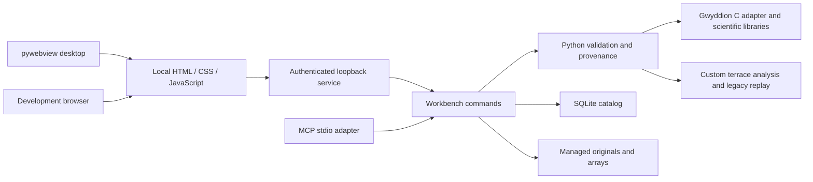

# Implemented architecture

The implementation decision of 2026-11-09 replaces the tentative Tauri/React/Python stack with a smaller Python/pywebview application. The user authorized implementation and independent product choices, and made folder-level sessions and spatial browsing explicit requirements.

`importers.py` extracts calibrated numerical data and original metadata. `science.py` owns validation, coordinates, invalid-pixel policies and measurement definitions. `native_backend.py` calls the versioned ABI in `native/afm_gwyddion.c`, linked to the real Gwyddion 2.71 scientific libraries. Native routines produce the processing arrays, statistics and profile values. Custom terrace processing in `auto_processing.py` and old methodless recipe replay remain separately identified Python implementations. `service.py` owns sessions, scans, recipes, measurements and export provenance. `server.py` transports typed service calls and serves bundled static assets. `mcp.py` adapts the same commands to JSON-RPC. `__main__.py` owns the desktop lifecycle and native file dialogs.

The 2026-11-10 user decision authorizes native Gwyddion as the primary scientific backend and GPL distribution. The backend is initialized when the workspace opens; a missing or incompatible library produces a setup error. History and measurement/export provenance record the Gwyddion version and adapter ABI/version. [Native build instructions](../native/README.md) describe dependencies and source distribution.

There is no Node build step or remote asset dependency. The service binds only to loopback, verifies the launch origin and request token, and does not offer arbitrary file reads through URLs. Native exports use a save dialog. Browser exports use downloads. The desktop and browser modes share identical frontend assets.

## Session identity

One folder becomes one session. Acquisition numbers are subdivisions for browsing within that session; channel and direction are attributes of images. A scan need not belong to a separately named sample to be analyzed. The catalog owns stable IDs, source hashes, review state, notes, processing recipes and optional sample assignment.

Scan offsets and extents remain separate from pixel calibration and display transforms. A map groups coincident channel footprints, preserves the gaps and overlap between acquisitions, and allows each underlying image to be opened. Thumbnail orientation and image registration are not inferred from a fit.

Map selection is temporary display state keyed by acquisition and recorded footprint, independent of filtered list indexes. Focus shows one image plus all outlines; All images draws the selected image last; Outlines omits raster previews. Pointer selection inverts the SVG viewport transform and recorded footprint rotation, then considers every footprint containing that point. Coincident acquisitions remain separate choices. Only the selected scan has a map label, with all acquisitions available in the scrollable list. No coordinates, pixels or recipes are changed by these controls.

## Folder imports and curation

The catalog migrates existing sessions to include an archive flag and source-location history. Archiving only changes library visibility. Reconnecting updates the current source path on the same session, records the former path, and leaves saved image/analysis records intact. Newly imported scan metadata includes the original source path and import timestamp.

GUI and MCP submit `start_import`, poll `import_status`, and can `cancel_import`. The synchronous `import_folder` command uses the same implementation. A dedicated import lock serializes imports, while a separate job lock makes progress and cancellation independent of catalog work. File reads, hashing, decoding, array writes and initial statistics run outside the catalog lock. Only one file's data is prepared at a time, then committed under a short catalog lock. Cancellation finishes the current file; committed scans remain and retries deduplicate by session, filename and source hash. No source file is overwritten. Job state is process-local; interrupted work resumes by reimporting the folder.

## Persistence and operations

Original files are copied into managed storage and checksummed. Operations are reproducible from the original calibrated array; they do not overwrite the original. GUI corrections save directly; undo restores the previous list of operations. The service also provides an unsaved preview command for clients. A numerical correction invalidates the applicability of previously measured values to the new result; exported provenance identifies its recipe and source.

The frontend owns temporary interaction state (current tool, color map, selection and contrast). The database owns persistent scientific and curation state. Display settings accompany figure/provenance exports and never enter the numerical recipe. Array display may be reduced for responsiveness; numerical operations use complete arrays.

## Processing responsiveness

The service reuses full-resolution recipe results and identical prefixes in a process-local LRU cache (128 MiB, at most 24 entries). Keys cover immutable array identity, metadata including calibration/orientation, and all operation parameters including resolved mask snapshots. Cached arrays are read-only and histories are independently decoded. A new correction computes only its uncached suffix through the same scientific core; an edited earlier step cannot reuse a different prefix. Failures do not change the saved recipe. Eviction and restart fall back to replay, with no persisted-cache migration required. The processing response uses the result just computed instead of replaying it, and contrast/measurements reuse that same full-resolution result.

PNG thumbnails have a separate 24 MiB / 256-entry LRU keyed by source, recipe, browse-leveling choice, palette and stored contrast settings. Both caches include key/entry allowances in their budgets and are discarded when the workspace closes. They do not cache editable mask statistics or replace source/provenance records.

The GUI requests `data_encoding: "f64le"` on scan, process, preview and update-scan calls. Display samples travel as base64 little-endian float64 bytes and decode into a typed array; calibration, precision and NaN locations are preserved. The default service/MCP response remains nested JSON pixels with null for invalid samples. Display sampling remains capped at 512 pixels per dimension, while numerical operations and range calculations remain full resolution. Canvas rendering interpolates colors directly into the RGBA buffer, and correction responses update the local scan summary without reloading the whole catalog.

Run `scripts/performance-smoke.py URL --expect-compact` using the desktop Python environment against a disposable server catalog to measure the complete native rendered workflow. See [measured results and correctness checks](validation.md#processing-performance-2026-11-13).

## Canvas fluidity

The frontend caches fitted image geometry when the canvas is bound, resized or moved by an ancestor's scroll. Pointer coordinates and zoom anchors then use that geometry with the viewport model, rather than forcing a layout read for each event. Every wheel delta updates the model, while hover readouts, pan transforms, selection drafts and live contrast presentation use the latest input once per animation frame. Pointer release flushes the pending endpoint before committing; cancellation invalidates pending visual work so an old callback cannot restore a discarded draft or undo Fit.

Scientific brush sampling remains separate from presentation. Every accepted brush sample enters the saved full-resolution stroke, while its cached preview path is updated in a retained SVG group at frame cadence. Other selection drafts retain their SVG nodes during a drag. Tool changes retain the image canvas, and pixel rendering reuses its `ImageData` allocation while dimensions remain constant. A paint key covers the exact limits, palette, dimensions and data-array reference, avoiding a repeat paint when those inputs are unchanged. These changes affect interaction and display work; GUI and MCP numerical algorithms, calibration and source data remain shared and unchanged.

Run `.venv/bin/python scripts/fluidity-smoke.py URL --expect-coalesced` with the desktop Python environment against a disposable source or rebuilt-application catalog. The script generates a 1024 × 1024 synthetic source with the normal 512 × 512 display and dispatches bounded input bursts through the production handlers. It reports instrumented JavaScript work, observed animation-frame intervals, layout/style reads, pixel writes and DOM mutations. The optional flag checks bounded visual work and retained canvas nodes alongside endpoint, cancellation, brush-coverage and numerical-invariance checks; omit it when collecting a baseline from an earlier version. These metrics do not measure physical-device latency or compositor/GPU work, and the checks use no hardware-dependent timing threshold. Executed measurements belong in [validation](validation.md).

## Scope boundaries

The implementation supports calibrated Park TIFFs and synthetic examples, rectangular regions and binary masks, profiles with linear/nearest interpolation and width averaging, plane/polynomial backgrounds, and all eight Gwyddion-style line alignment methods. See the [compatibility audit](gwyddion-compatibility.md) for precise scope. Automatic mode includes masked spatial terrace references, up to three fitted planes, and optional scan-axis background offsets. These are processing proposals with recorded assumptions, not general instrument drift calibration or material identification. Image stitching, a shared server and embedded AI interpretation are not implemented. Build recipes target Mac and Windows; tested-platform evidence is recorded separately in [validation](validation.md).
